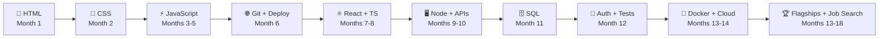

# 🚀 Zero → Full-Stack Developer

### My 17-month journey from absolute beginner to job-ready, in public.


*No CS degree. No shortcuts. One protected hour at a time.*

</div>

---

## 👋 About This Repo

Hi, I'm **Anuj**. I'm learning to build software from scratch, with no computer science background, and I'm documenting every step here.

This repo is my **roadmap, my progress tracker, and my proof of work**. Everything I build ends up linked below, live and deployed.

> **The rule I'm following:** *Never commit a line of code I could not have written myself and cannot explain.*

---

## 🧭 The Big Picture



---

## 📊 Progress Tracker

**Overall:** `░░░░░░░░░░░░░░░░░░░░` 0%

| # | Phase | Time | Status | Milestone |
|:-:|-------|:----:|:------:|-----------|
| 0 | 🛠️ Setup | Week 1 | ⬜ | VS Code, Node, Git, first `index.html` live |
| 1 | 🧱 HTML | Month 1 | ⬜ | Five static pages from scratch |
| 2 | 🎨 CSS | Month 2 | ⬜ | A responsive site that looks genuinely good |
| 3 | ⚡ JavaScript | Months 3–5 | ⬜ | Six interactive apps, one my own idea |
| 4 | 🌐 Git & Deploy | Month 6 | ⬜ | Everything on GitHub, three projects live |
| 5 | ⚛️ React + TypeScript | Months 7–8 | ⬜ | Multi-page React app with routing |
| 6 | 🖥️ Back End | Months 9–10 | ⬜ | First full-stack app, both halves mine |
| 7 | 🗄️ Databases | Month 11 | ⬜ | Properly designed Postgres behind my API |
| 8 | 🔐 Auth, Security, Tests | Month 12 | ⬜ | Real logins, roles, test suite |
| 9 | 🐳 Deploy & Ops | Months 13–14 | ⬜ | CI/CD, monitored, on my own domain |
| 10 | 🏆 Flagship Projects | Months 13–17 | ⬜ | Three portfolio-grade projects |
| 11 | 🧮 DSA (parallel) | Months 7–18 | ⬜ | ~220 problems, mediums comfortable |
| 12 | 💼 Job Search | Months 15–18 | ⬜ | Applications → interviews → offer |

> Legend: ⬜ not started · 🟨 in progress · ✅ done. I update this table every Sunday.

---

## 🎯 Phase Details

<details>
<summary><b>🛠️ Phase 0 — Setup (Week 1)</b></summary>

- [ ] Install **Chrome/Firefox** and learn **DevTools** (`F12`)
- [ ] Install **VS Code** + Prettier, ESLint, Live Server, Error Lens
- [ ] Set up the **terminal** (WSL2 on Windows) and learn 15 core commands
- [ ] Install **Node.js** via `nvm`
- [ ] Install **Git** and create a **GitHub** account
- [ ] Create `~/code/{learning,projects,notes}`
- [ ] Build and open my first `index.html` with Live Server

```bash
mkdir -p ~/code/learning ~/code/projects ~/code/notes
```
</details>

<details>
<summary><b>🧱 Phase 1 — HTML (Month 1, ~40 hrs)</b></summary>

- [ ] Week 1: structure, headings, links, images, lists, paths
- [ ] Week 2: semantic HTML (`header`, `nav`, `main`, `section`, `footer`)
- [ ] Week 3: forms, inputs, labels, validation, tables
- [ ] Week 4: accessibility, SEO meta tags, validate at validator.w3.org

**Build:** profile page · recipe page · job application form · 3-page site · copy a real page's skeleton

**✅ Done when:** I can write a valid page from an empty file without looking anything up.
</details>

<details>
<summary><b>🎨 Phase 2 — CSS (Month 2, ~55 hrs)</b></summary>

- [ ] Selectors, the cascade, specificity, inheritance
- [ ] The box model + `box-sizing: border-box`
- [ ] `display`, `position`, `z-index`
- [ ] **Flexbox** (play Flexbox Froggy)
- [ ] **Grid** (play Grid Garden) + responsive design, mobile-first
- [ ] Transitions, CSS variables, then **Tailwind**

**Build:** styled profile · pricing table · rebuild a site from a screenshot · Frontend Mentor challenges

**✅ Done when:** I can build a responsive 3-section landing page from a screenshot in 90 minutes.
</details>

<details>
<summary><b>⚡ Phase 3 — JavaScript (Months 3–5, ~170 hrs)</b></summary>

**Month 3 — Language basics**
- [ ] Variables, types, coercion, `===`
- [ ] Control flow and loops
- [ ] **Functions** (spend two full weeks here)
- [ ] Arrays, objects, `map` / `filter` / `reduce`, destructuring, JSON

**Month 4 — Browser + async**
- [ ] The DOM, events, bubbling and delegation
- [ ] Callbacks → Promises → `async/await`
- [ ] `fetch`, HTTP methods, status codes
- [ ] The event loop

**Month 5 — Depth**
- [ ] Closures, `this`, prototypes, classes
- [ ] ES modules, `localStorage`
- [ ] Real debugging (breakpoints, not just `console.log`)
- [ ] npm and Vite

**Build:** Calculator · To-do · Quiz app · Weather app · Expense tracker · **one thing from my own life**

> ⚠️ **Expect a wall** around week 3–4. It's normal. Slow down and do more small exercises.

**✅ Gate:** build a fetch-and-display app with search + loading state, no tutorial, in one sitting. *If I can't, I don't move to React.*
</details>

<details>
<summary><b>🌐 Phase 4 — Git, GitHub & Going Live (Month 6)</b></summary>

- [ ] `init`, `add`, `commit`, `push`, `pull`
- [ ] Branches, merging, **resolving a merge conflict on purpose**
- [ ] Pull requests (review my own)
- [ ] `.gitignore` (never commit secrets)
- [ ] Deploy to **Netlify / Vercel**, buy a custom domain
- [ ] README on every project, meaningful commit messages
</details>

<details>
<summary><b>⚛️ Phase 5 — React + TypeScript (Months 7–8, ~110 hrs)</b></summary>

- [ ] Components, JSX, props, state
- [ ] Lists + keys, conditional rendering, controlled forms
- [ ] `useEffect` (and when *not* to use it)
- [ ] Custom hooks (write 3), React Router
- [ ] **TanStack Query**, React Hook Form + Zod
- [ ] **TypeScript** basics

**Build:** expense tracker in React+TS · movie/book browser · multi-view dashboard
</details>

<details>
<summary><b>🖥️ Phase 6 — Back End (Months 9–10, ~110 hrs)</b></summary>

- [ ] Node.js, environment variables
- [ ] Express: routing, middleware, validation (Zod), error handling
- [ ] REST API design, CORS
- [ ] Layered architecture: routes → controllers → services → data
- [ ] File uploads, email, background jobs, rate limiting, logging
- [ ] Connect React to **my own API** for the first time 🎉
</details>

<details>
<summary><b>🗄️ Phase 7 — Databases & SQL (Month 11, ~55 hrs)</b></summary>

- [ ] `SELECT`, `WHERE`, aggregates, `GROUP BY`, `HAVING`
- [ ] Keys, relationships, all the `JOIN`s, CTEs
- [ ] `CREATE TABLE`, constraints, normalisation (1NF–3NF), transactions
- [ ] Indexes, `EXPLAIN ANALYZE`, the **N+1 problem**
- [ ] ORM (Prisma/Drizzle) *after* raw SQL, migrations

**Why PostgreSQL over MongoDB?** Relational thinking transfers; SQL is what interviews test.
</details>

<details>
<summary><b>🔐 Phase 8 — Auth, Security & Testing (Month 12, ~55 hrs)</b></summary>

- [ ] Password hashing (bcrypt/argon2), sessions vs JWT, refresh tokens
- [ ] Role-based access control, checked **on the server**
- [ ] OWASP Top 10: SQL injection, XSS, broken access control, secrets
- [ ] Tests: **Vitest** (unit) · **Supertest** (integration) · **Playwright** (E2E)
</details>

<details>
<summary><b>🐳 Phase 9 — Deployment & Operations (Months 13–14, ~85 hrs)</b></summary>

- [ ] Docker, `Dockerfile`, `docker-compose`
- [ ] GitHub Actions CI/CD (lint + typecheck + tests, auto-deploy)
- [ ] Railway/Render first, then **AWS** (EC2, S3, RDS, IAM, Nginx)
- [ ] HTTPS + custom domain
- [ ] Sentry, structured logging, tested backups, rollback, cost awareness

> 🎤 *The interview line this buys me:* "p95 was 800 ms, I found the slow query with `EXPLAIN`, added a composite index, and it dropped to 60."
</details>

---

## 🪜 The Project Ladder

| # | Project | Month | New skill |
|:-:|---------|:-----:|-----------|
| 1 | Personal profile page | 1 | HTML structure |
| 2 | Styled multi-page site | 2 | CSS layout, responsive |
| 3 | Calculator | 3 | DOM + events |
| 4 | Quiz app with timer | 4 | State, timers |
| 5 | Weather app (public API) | 4 | `fetch`, async/await |
| 6 | Expense tracker + charts | 5 | Aggregation, libraries |
| 7 | Movie browser (React) | 7 | Components, routing |
| 8 | Multi-view dashboard | 8 | Shared state, TypeScript |
| 9 | Blog with my own API | 10 | First full-stack app |
| 10 | 🏆 **Flagship 1**: a real tool for a real problem | 11–13 | DB design, auth, deployment |
| 11 | 🏆 **Flagship 2**: something from a domain I know | 13–15 | Business rules, background jobs |
| 12 | 🏆 **Flagship 3**: technically ambitious | 15–17 | Real-time / performance / AI |

### 🏆 Flagship rules

- ❌ **No clones** (Netflix, Twitter, e-commerce templates)
- ✅ Solves a **real problem** I've actually seen
- ✅ **Live** on a real URL with a demo login
- ✅ README with a *"trade-offs and what I'd do differently"* section
- ✅ **Tests + CI**, incremental commit history
- ✅ A 2–3 minute **demo video**

---

## 🔗 My Projects

<!-- Update this table as projects ship -->

| Project | Live | Code | Stack | Status |
|---------|:----:|:----:|-------|:------:|
| Profile page | _soon_ | _soon_ | HTML | ⬜ |
| Calculator | _soon_ | _soon_ | JS | ⬜ |
| Weather app | _soon_ | _soon_ | JS + API | ⬜ |
| Flagship 1 | _soon_ | _soon_ | TBD | ⬜ |

---

## 🧮 DSA Tracker

> **Goal:** ~220 problems, genuinely understood, not 600 memorised. **Ratio:** 1 hour DSA : 3 hours building. **Start:** Month 7.

| Pattern | Target | Done |
|---------|:------:|:----:|
| Arrays & hash maps | 25 | 0 |
| Two pointers | 15 | 0 |
| Sliding window | 15 | 0 |
| Strings | 12 | 0 |
| Binary search | 12 | 0 |
| Stacks & queues | 12 | 0 |
| Linked lists | 15 | 0 |
| Recursion | 10 | 0 |
| Trees | 28 | 0 |
| Graphs (BFS/DFS) | 22 | 0 |
| Heaps / top-K | 8 | 0 |
| Backtracking | 10 | 0 |
| Dynamic programming | 25 | 0 |
| Greedy & intervals | 10 | 0 |

**Method:** attempt 25 min → read the *approach* only → write complexity every time → log it → re-solve at 7 and 30 days → narrate aloud from Month 12.

**Primary list:** NeetCode 150 *(or Striver's SDE Sheet, pick one)*

---

## 🗓️ My Weekly Schedule

```text
Mon   06:30–08:00   New concept (read + type examples)         1.5h
Tue   06:30–08:00   New concept (continued + exercises)        1.5h
Wed   21:00–22:30   Practice / DSA                             1.5h
Thu   06:30–08:00   Project work                               1.5h
Fri   ——            OFF. Deliberately.                         0h
Sat   09:00–13:00   Deep project work (protected block)        4h
Sun   10:00–12:30   Project/learning + 30 min weekly review    3h
                                                       Total  13h
```

### 🔒 My 6 Rules

1. **Build, don't watch.** 30 min of input : 90 min of building.
2. **Type every example by hand.** No copy-paste while learning.
3. **Break things on purpose.** Error messages are the best teacher.
4. **Confusion is the job.** Sit with it 30 minutes, try three things, then look it up.
5. **Finish things, even badly.** Ship ugly.
6. **Consistency beats intensity.** Never break the chain twice.

---

## 🧠 How I Learn

```text
1. Learn ONE small concept (20–30 min)
2. Type the examples by hand
3. Break them and predict the result
4. Build something tiny that wasn't in the lesson   ← the step that matters
5. Write a note in my own words
6. Rebuild it from memory a week later
```

### 🐛 My Debugging Procedure

1. Read the **entire** error message
2. Reproduce it reliably
3. State a hypothesis
4. Test **one** thing at a time
5. Narrow it down (comment out half)
6. Use the **debugger**, not just `console.log`
7. Explain it aloud

### 🤖 AI Policy

| ✅ Good uses | ❌ Bad uses (Months 1–8) |
|-------------|------------------------|
| Explain an error I don't understand | "Build this feature for me" |
| Ask *why* something works after I wrote it | Pasting output without reading it |
| Generate practice exercises | Skipping the docs |
| Review my code for weaknesses | Letting it debug before I've tried |

> **From Month 9** I can use it more freely for speed, but the core rule never changes: *I must be able to rewrite and explain every line.*

---

## ✅ Milestone Self-Tests

| Checkpoint | The test |
|-----------|----------|
| **Month 2** | Responsive 3-section landing page from a screenshot in 90 min |
| **Month 5** 🚧 | Fetch-and-display app with search + loading, no tutorial, one sitting; explain `await`; find a bug with the debugger |
| **Month 8** | React app with 3 routes, API list, detail page, filter, in one weekend |
| **Month 11** | Schema on paper in 30 min; 3-table `JOIN` + `GROUP BY` + `HAVING` from memory; full CRUD API in a day |
| **Month 14** | Deploy a project to a fresh server with HTTPS + DB in under 4 hours |
| **Month 17** 🏁 | 3 live flagships with tests + CI; ~200 DSA problems; 3 mock interviews |

> If a milestone fails: don't push on, don't restart. Find the weak concept, spend 2–3 weeks on it, retest.

---

## 📚 Resources (one primary per stage)

| Stage | Use this |
|-------|----------|
| 🗺️ Overall | [The Odin Project](https://www.theodinproject.com) · [Full Stack Open](https://fullstackopen.com) |
| 🧱 HTML & CSS | freeCodeCamp · [MDN](https://developer.mozilla.org) · Flexbox Froggy · Grid Garden · Frontend Mentor |
| ⚡ JavaScript | [javascript.info](https://javascript.info) *(primary)* · Eloquent JavaScript |
| 🌐 Git | [Learn Git Branching](https://learngitbranching.js.org) |
| ⚛️ React | [react.dev](https://react.dev) |
| 🔷 TypeScript | Official Handbook · Total TypeScript (free) |
| 🗄️ SQL | SQLBolt · PostgreSQL Exercises · *Use the Index, Luke* |
| 🔐 Security | PortSwigger Web Security Academy · OWASP Top 10 |
| 🐳 DevOps | Docker getting-started · roadmap.sh |
| 🧮 DSA | NeetCode 150 · Striver's SDE Sheet |
| 🧠 CS basics | Julia Evans' zines · CS50 |
| 💬 Community | r/developersIndia · Reactiflux · Delhi NCR meetups |

---

## 🇮🇳 India Job-Search Notes

- **Large IT services & many MNC captives** → usually filter on B.Tech. Low priority.
- **Funded product startups, mid-size product companies, agencies** → mostly hire on demonstrated skill. **Primary targets.**
- Having *any* bachelor's degree clears most "graduate required" filters.
- **Start applying around Month 15**, once one flagship is live. Early interviews are diagnostic.
- Check **AmbitionBox**, **Glassdoor India** and **levels.fyi** for current pay bands rather than trusting a static number.

---

## 📝 Weekly Review Template

Every Sunday, 30 minutes. Copy into `notes/week-XX.md`:

```md
## Week N — YYYY-MM-DD

**Hours logged:** __ / 13
**Phase:** ______   **On track for this month's milestone?** Y / N

**Finished:**
**Stuck on:**
**DSA solved:** __   **Weak patterns:**
**Single most important outcome for next week:**
```

---

## 📁 Repo Structure

```text
.
├── README.md        ← you are here
├── learning/        ← exercises and scratch work
├── projects/        ← portfolio-grade projects
└── notes/           ← weekly reviews and learning journal
```

---

<div align="center">

### 💬 Let's Connect

[](https://github.com/Anujbarwal)
[](https://linkedin.com/in/anuj-barwal)

*"Consistency beats intensity, every time."*

⭐ If this roadmap helps you, star the repo, and start your own `index.html` today.

</div>
